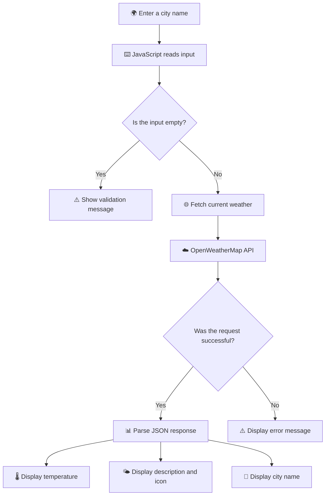

# 🌦️ Live Weather Dashboard

<div align="center">


<br/>

<a href="https://saheera-006.github.io/Live-Weather-Dashboard/">
  
</a>
<a href="https://github.com/Saheera-006/Live-Weather-Dashboard">
  
</a>

<br/><br/>


<br/><br/>


</div>

---

## ✦ About the Project

**Live Weather Dashboard** is a lightweight web application that allows users to check the current weather conditions of any supported city.

Built using HTML, CSS, and vanilla JavaScript in a single HTML file, it fetches real-time weather data from the **OpenWeatherMap Current Weather API** and displays the temperature, weather description, city name, and corresponding weather icon.

The interface features a vibrant blue gradient background and a simple, easy-to-use search experience.

> *One city. One search. A clearer picture of the weather.*

## ✨ Features

| Feature | Description |
|---|---|
| 🌍 **City Search** | Search for current weather by entering a city name. |
| 🌡️ **Temperature Display** | View the temperature in Celsius. |
| ☁️ **Weather Description** | See a description of the current weather conditions. |
| 🌤️ **Weather Icons** | Display the icon returned by the weather API. |
| ⚡ **Live API Integration** | Retrieve current weather data through the JavaScript Fetch API. |
| ⌨️ **Enter-Key Search** | Press Enter to submit a city search. |
| ✅ **Input Validation** | Display a message when the city field is empty. |
| ⚠️ **Error Handling** | Show an error message when a weather request fails, including when a city is not found. |
| 🎨 **Gradient UI** | Enjoy a clean interface with a blue gradient background. |
| 📱 **Flexible Layout** | Use a centered, width-constrained layout that adapts to available screen space. |

## 🧰 Tech Stack

<div align="center">

| Technology | Purpose |
|:---:|---|
| **HTML5** | Defines the webpage structure and weather result elements |
| **CSS3** | Provides styling, layout, colors, spacing, and hover effects |
| **JavaScript** | Handles search events, input validation, API requests, and result rendering |
| **Fetch API** | Sends asynchronous HTTP requests to the weather service |
| **OpenWeatherMap API** | Supplies current weather information |
| **GitHub Pages** | Hosts the static website |

</div>

## ⚙️ How It Works



### Request and rendering flow

1. The user enters a city name into the search field.
2. JavaScript trims the input and checks whether it is empty.
3. The Fetch API sends a request to OpenWeatherMap with metric units enabled.
4. The application checks the HTTP response status.
5. On success, JavaScript extracts the city name, temperature, weather description, and icon code from the JSON response.
6. The weather information is rendered dynamically in the webpage.
7. If the request fails, an error message is displayed.

## 🖥️ User Interface

The dashboard uses a simple visual design focused on quick access to weather information.

- A blue gradient background.
- A centered, translucent weather container.
- A city search field and action button.
- A large temperature display.
- A weather description and corresponding icon.
- A dedicated area for validation and request errors.

## 🚀 Run Locally

### Prerequisites

- A modern web browser.
- Git, if you want to clone the repository.
- An OpenWeatherMap API key.

### 1. Clone the repository

```bash
git clone https://github.com/Saheera-006/Live-Weather-Dashboard.git
```

### 2. Open the project folder

```bash
cd Live-Weather-Dashboard
```

### 3. Configure the API key

Create or obtain an API key through [OpenWeatherMap](https://openweathermap.org/api).

In `index.html`, find the API key declaration:

```javascript
const apiKey = 'YOUR_OPENWEATHERMAP_API_KEY';
```

Replace the placeholder with your own valid key.

**Note:** The key shown above is a placeholder. Do not publish your actual unrestricted API key in a public repository.

### 4. Run the application

Open `index.html` in a web browser. No build process or package installation is required.

Enter a city name and select **Get Weather** to retrieve the current weather information.

## 🌐 Live Demo

<div align="center">

### Ready to check the weather?

<a href="https://saheera-006.github.io/Live-Weather-Dashboard/">
  
</a>

<br/><br/>

**Repository:** [Saheera-006/Live-Weather-Dashboard](https://github.com/Saheera-006/Live-Weather-Dashboard)

**Deployment:** GitHub Pages

</div>

## 📁 Project Structure

```text
Live-Weather-Dashboard/
│
├── index.html    # HTML structure, embedded CSS and JavaScript
└── README.md     # Project documentation
```

The application is implemented in a single HTML file. The styling and JavaScript logic are embedded directly within `index.html`.

## 🧠 What I Learned

Working on this project helped me practise:

- Integrating a third-party REST API into a web application.
- Making asynchronous requests using JavaScript Fetch.
- Processing JSON data returned by an API.
- Updating HTML content dynamically with JavaScript.
- Validating user input before making requests.
- Handling unsuccessful HTTP responses and displaying error messages.
- Creating a simple, visually engaging web interface.
- Deploying a static website with GitHub Pages.

## 🔐 Security Considerations

This project makes API requests directly from the browser. Consequently, any API key included in the client-side JavaScript can be viewed by visitors.

For a public deployment:

- Never assume a client-side API key is secret.
- Restrict the key to the required API and permitted website origins wherever the provider supports those restrictions.
- Monitor API usage and rotate exposed keys when necessary.
- For stronger credential protection, use a backend service to keep sensitive credentials out of client-side code.

## 🔮 Potential Enhancements

Possible future improvements include:

- Displaying humidity, wind speed, and feels-like temperature.
- Adding a multi-day weather forecast.
- Providing recent-search history.
- Improving loading and error states.
- Adding weather-responsive themes and accessibility improvements.

*These are potential enhancements, not features currently claimed as implemented.*

## 👩‍💻 About the Developer

**Fathima Saheera J**  
*Aspiring Full Stack Developer*

I enjoy building practical web applications, exploring APIs, and improving my skills through hands-on projects.

- **GitHub:** [@Saheera-006](https://github.com/Saheera-006)
- **Project Repository:** [Live Weather Dashboard](https://github.com/Saheera-006/Live-Weather-Dashboard)
- **Live Website:** [Explore the Dashboard](https://saheera-006.github.io/Live-Weather-Dashboard/)

---

<div align="center">


**Built with curiosity, code, and a little sunshine.** ☀️

*Thanks for visiting! If you like this project, consider giving the repository a ⭐.*

</div>
